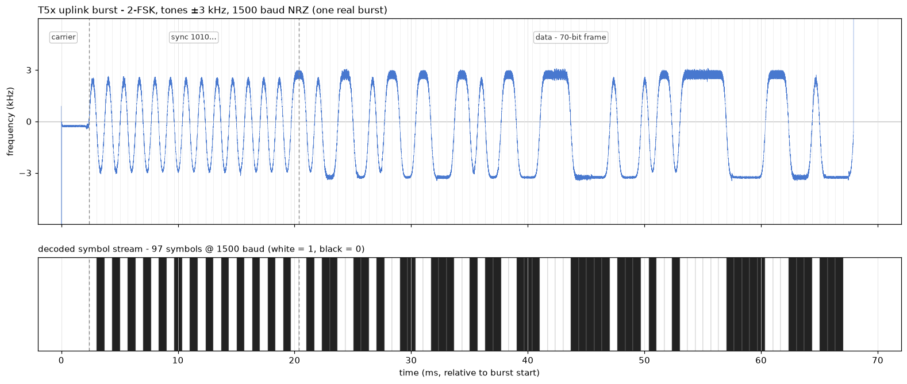
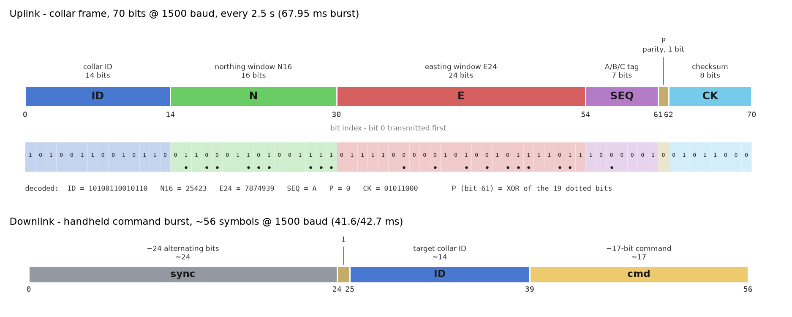
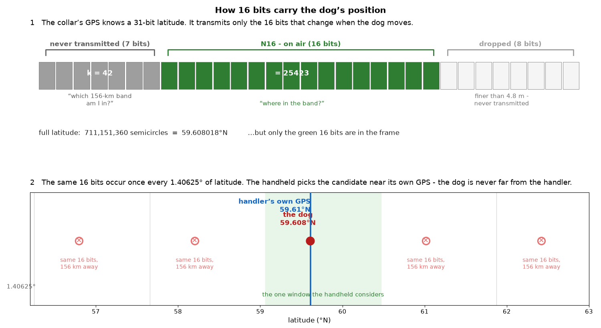
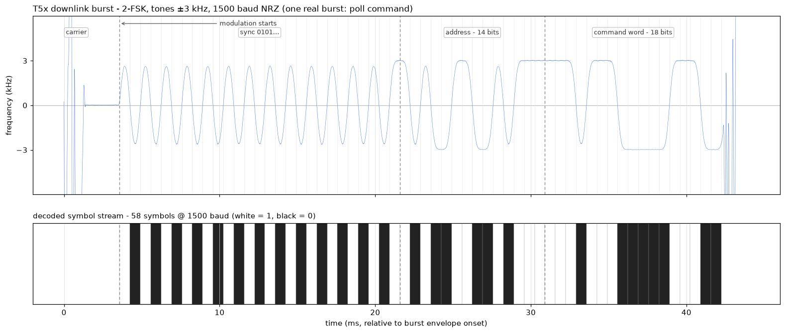

# T5x Collar Protocol Specification

> **Disclaimer — the parity bit (P) is not fully resolved.** The P-bit law in
> §2.3 is a fit from a single collar in a single longitude region: the four
> most significant E24 bits never varied there, so their coefficients are
> undetermined (and the ID-bit and SEQ coefficients are not identifiable from
> one collar). The law holds with zero errors on every certified frame
> recorded so far, but it is not proven unique.


An unofficial, reverse-engineered specification of the 155.450 MHz radio
protocol between one EU Garmin T5x collar and its paired Alpha 100 handheld,
derived entirely from passive radio observation. It defines the physical layer;
the collar's 70-bit uplink frame, including position, sequence, parity, and
GF(2) checksum; and the handheld downlink command format. Field names and
downlink command identifiers are assigned by this document.

## 1. Physical layer



| Parameter | Value |
|---|---|
| Carrier frequency | 155.4500 MHz (EU T5 band) |
| Modulation | 2-FSK, tones fc ± 3.0 kHz, pulse-shaped (~0.33 T ramps) |
| Symbol rate | 1500 baud, NRZ |
| Burst | 67.95 ms ≈ 101 symbols: 2.5 ms unmodulated carrier, ~26 alternating sync symbols, 70 data symbols |
| Slot period | 2.5 s (2.49–2.51 s), one frame per slot |
| Emission designator | 7K45F1D |

Every frame is **self-contained**: full position, status, and checksum
travel in each transmission. No frame depends on another.

The frame boundary is tone-invisible: the last sync symbol and the first ID
bit are the same value in every observed burst, so NRZ shows no transition
there. A receiver locates the frame by counting symbols from modulation
start (or by ID correlation), not by watching for an edge.

## 2. Uplink frame (70 bits)



| Bits | Field | Content |
|---|---|---|
| 0–13 | ID | Collar identifier (14 bits) |
| 14–29 | N16 | Northing position window (16 bits) |
| 30–53 | E24 | Easting position window (24 bits) |
| 54–60 | SEQ | TX counter mod 3: A = `1000001`, B = `0000000`, C = `0011011` |
| 61 | P | Payload parity bit (§2.3) |
| 62–69 | CK | Checksum (§2.4) |

### 2.1 Position encoding

Position is transmitted as windowed slices of the Garmin semicircle unit,
`sc = 180° / 2³¹`, the native angular unit of Garmin GPS engines:

```
N16 = ( sc_lat >> 8 )  mod 2^16        LSB = 2^8 sc  ≈ 4.78 m
E24 = ( sc_lon >> 3 )  mod 2^24        LSB = 2^3 sc  ≈ 3.8 cm (φ-dependent)
```



- N16/E24 resolution ratio = 2⁻⁵ = 1/32.
- Windows wrap every 2²⁴ sc = **1.40625° latitude** (~156 km) and 2²⁷ sc =
  **11.25° longitude** (~630 km at 60°N).
- N16/E24 are absolute: the low bits of the global semicircle counts, in the
  same frame as the receiver's GPS fix.
- Decoding: `lat = (N16 · 2⁸ + k · 2²⁴) · sc`, `lon = (E24 · 2³ + m · 2²⁷) · sc`,
  with wrap counts k, m derived from the receiver's own GPS fix.
- N16 increases northward, E24 eastward.

Absolute accuracy from one checksum-valid frame: ~2.4 m N16, ~4 cm E24,
given wrap resolution.

**Relation to other Garmin formats.** The semicircle unit itself is public
- it is the coordinate unit of the FIT SDK (`degrees = semicircles × 180/2³¹`)
and of Garmin serial-interface devices; the GDL 90 spec even defines 24-bit
semicircles. The windowing - transmitting only the low 16/24 bits and letting
the receiver resolve the wrap - is not part of any published Garmin
specification. Full-precision serial/FIT position messages send all 31 bits;
the T5x link sends only enough bits to be unambiguous within one reception
area.

### 2.2 Sequence tag (SEQ)

The tag cycles A → B → C → A with each transmission (TX counter mod 3).
At a fixed position the three frames do not report identical E24 values:
B reads ≈ 25 counts below A, C ≈ 1 below (1 count ≈ 3.8 cm), with the same
offsets at every static location. The cycle is therefore one shared
navigation solution reported three times with a fixed per-tag bias - not
three independent fixes. N16 is unaffected. A receiver averaging positions
across a cycle must remove these offsets first, or it gains ≈ 1 m of error.

**D variant.** A fourth tag value, `0010001`, occurs in place of A in the
otherwise regular A/B/C cycle. It has not been observed in motion, and its
trigger is unknown. Its position and parity fields use the ordinary layout.
For the matrix printed below, its received checksum is represented by
`CK(D) = CK_H ⊕ 10110110`, where `CK_H` is the checksum calculated from the
62 frame bits. This offset is a decoding convention, not a demonstrated
collar constant: an alternative weighting of the SEQ columns certifies the
same D frames without an offset.

### 2.3 P bit

Each frame carries one parity bit P (bit 61): the XOR of nineteen selected
frame bits -

```
P =  bit 15 ⊕ bit 17 ⊕ bit 18 ⊕ bit 21 ⊕ bit 22 ⊕ bit 23 ⊕ bit 27
   ⊕ bit 28 ⊕ bit 29 ⊕ bit 36 ⊕ bit 39 ⊕ bit 42 ⊕ bit 44 ⊕ bit 46
   ⊕ bit 47 ⊕ bit 48 ⊕ bit 51 ⊕ bit 52 ⊕ bit 56
```

- counted from the frame start as in the table above. Nine lie in N16
  (weights 2⁰, 2¹, 2², 2⁶, 2⁷, 2⁸, 2¹¹, 2¹², 2¹⁴), nine lie in E24
  (weights 2¹, 2², 2⁵, 2⁶, 2⁷, 2⁹, 2¹¹, 2¹⁴, 2¹⁷), and bit 56 lies in
  SEQ. Bit 56 is 0 for A and B and 1 for C and D.

The coefficients of the four most significant bits of E24 (frame bits
30-33) are unresolved: those bits are constant within any one longitude
window, so a single-region observation cannot determine them. Every
other coefficient is fixed.

### 2.4 Checksum

CK (bits 62-69) is an eight-bit GF(2)-linear check over frame bits 0-61. Each
matrix row below contains 62 coefficients: the leftmost coefficient applies to
frame bit 0 and the rightmost to frame bit 61. A `1` includes that frame bit
in the row XOR; a `0` excludes it.

To validate a received frame:

1. For each row CK62 through CK69, XOR the frame bits selected by its `1`
  coefficients. Concatenate the eight results as `CK_H`.
2. Compare `CK_H` with the received bits 62-69. A frame is valid when they
  match, equivalently when `SYN = CK_H ⊕ CK_received` is `00000000`.

There is no additive constant. The CK69 row is all-zero, so bit 69 is always
0 and the check has seven non-trivial functions. Frames can be validated
independently, without continuity tracking.

```
CK62: 10000000000000101011011110001100000001001001000110001100000010
CK63: 10000000000000110101101111000000000001100100110010100000000000
CK64: 10000000000000111010100111100100000000110010001001110100000010
CK65: 10000000000000001011011111101100001010001011111011100000000010
CK66: 10000000000000110011100011101000001110010111010011001100000010
CK67: 00000000000000011001110001110000001111001011111000100000000010
CK68: 10000000000000101100111000111100000110100101111100110100000000
CK69: 00000000000000000000000000000000000000000000000000000000000000
      |------------ coefficients for frame bits 0..61, left to right -|
```

### 2.5 Worked example

```
1010011001011001100011010011110111100000101001011110111000001001011000

ID    = 10100110010110
N16   = 25423          -> (25423·256 + 42·2^24)·sc = 59.608018° N
E24   = 7874939        -> (7874939·8 + 1·2^27)·sc  = 16.530558° E
SEQ = A (1000001), P = 0 (parity law ✓), CK = 01011000  -> syndrome 00000000 ✓
```

## 3. Downlink (handheld to collar)

### 3.1 Physical layer



| Property | Value |
|---|---|
| Carrier | 155.44982 MHz (−180 Hz from the collar channel) |
| Modulation | 2-FSK ±3 kHz, 1500 baud NRZ |
| Burst | 42.2 ms envelope = 58 symbols: ~5.3 ms unmodulated carrier, 27 alternating sync symbols, 31-bit command frame |
| Cadence | Clusters; intra-cluster spacing = multiples of 0.125 s (8 Hz scheduler tick) |
| Idle paired handheld | Quiescent - bursts indicate command activity |

The carrier is released exactly at the end of the last symbol; there is no
postamble.

### 3.2 Command frame (31 bits)

```
[ 27 alternating sync bits ][ collar ID (14 bits) ][ command word (17 bits) ]
```

The address is the target collar's uplink ID bits 0-13. Ordinary commands
transmit that value unchanged. Poll D3 transmits the same address with bit 13
inverted. The collar-side meaning of that difference is unknown.

The identifiers below are assigned by this document:

| ID | Word (17 bits) | Function |
|---|---|---|
| D1 | `10000100000101000` | light blink fast |
| D2 | `10001001101011100` | light continuous |
| D3 | `11101110000011100` | poll - the only transmission a paired idle handheld emits |
| D5 | `10010000111010000` | light blink slow |
| D6 | `10000001011011000` | light off |
| D8 | `10100000010101100` | light blink fast |
| D9 | `11010001101101100` | unknown |
| D10 | `11001111001101000` | unknown |
| D11 | `10110001110100100` | unknown |

The table lists every command word currently known. D4 and D7 are not
assigned.

The last eight word bits are constant per command. Across commands only
bit 0 (`1`) and the final two bits (`00`) are shared; all nine observed
words end in `00` (1/256 if chance). Checksum, code extension, or marker -
not established. Standard checksums (CRC-8 over all polynomials, XOR-fold,
additive) test negative against every plausible covered span; a GF(2)
check like the uplink's cannot be confirmed or rejected from single-collar
data. A second collar would discriminate: an address-dependent tail is a
checksum, an identical tail is command code. The T20 collar's words for
the same four light functions are numerically disjoint from the D-series,
so the word encodes more than the bare function - target model or unit,
checksum, or both.

## 4. Observed device behavior

- **Position dynamics**: N16 is bit-frozen at rest outdoors; E24 low bits
  jitter ±0.6 m (live navigation noise). Indoors or under blocked sky the
  position estimate wanders (tens of meters over minutes). A ~30–60 s
  post-boot convergence window includes position overshoot. In vehicle
  transit, E24 overshoots ~3× and re-settles within 15–25 s of stopping.
- **Treed indication**: not transmitted. The receiver infers "dog
  stationary" from the position history; no on-air treed flag or event
  burst exists. A receiver applying the same stillness rule to the
  position stream observes the same state.
- **Channel access**: the collar transmits on its 2.5 s slot
  unconditionally; slot skips occur only under a dense downlink cluster
  (LBT-like behavior, unconfirmed).

## 5. Open items

| Item | Status |
|---|---|
| SEQ tag purpose | Unknown - observed cycling A/B/C (TX counter mod 3); receiver use not established |
| P participation of E24 top four bits | Undetermined - never varied in any recording (single longitude band); re-test against a distant collar |
| Downlink command functions | D1 = blink fast, D2 = continuous, D5 = blink slow, D6 = off, D3 = poll; D8 = blink fast; D9/D10/D11 unknown |
| Downlink word tail | Last 8 word bits constant per command; all 9 words end `00` - checksum, code extension, or marker, open |
| Poll address bit | Polls transmit collar-ID bit 13 as 1 (commands 0); purpose unknown |
| Universality | Predicted for any collar; single-unit document |
| Internal counter width | Internal counters may exceed the transmitted windows |